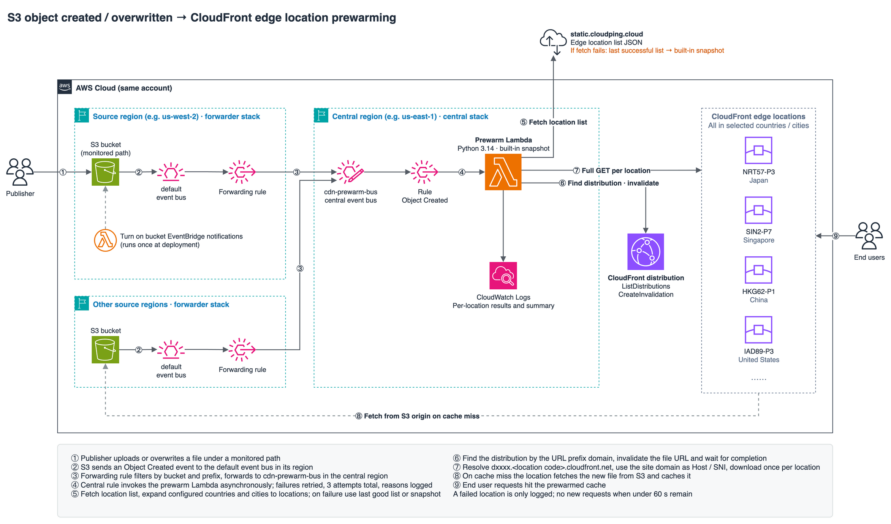

# Edge prewarming for Amazon CloudFront

English | [简体中文](README.zh-CN.md)

This sample prewarms Amazon CloudFront edge caches when content in Amazon S3 changes. When an object is created or overwritten under a configured S3 path, an AWS Lambda function downloads it once from every edge location in the countries or cities you choose, so those locations cache the new version before users ask for it.

> **Disclaimer.** This is sample code for demonstration and learning. Do your own security, cost and operational review and testing before using it in production.



```
S3 bucket (any region) ──> default event bus ──forwarding rule──> cdn-prewarm-bus (central region) ──> prewarm Lambda
                                                                                      1. invalidate the URL
                                                                                      2. GET it from each edge location
```

## Deployment

The buckets, the CloudFront distributions and the central stack must be in the same AWS account.

**1. Deploy the central stack** once, in any region:

```bash
aws cloudformation deploy --region us-east-1 --stack-name cdn-prewarm \
  --template-file dist/cdn-prewarm-central.yaml --capabilities CAPABILITY_IAM \
  --parameter-overrides \
    "S3Paths=bucket-a/static/;bucket-b/img/" \
    "CdnUrlPrefixes=https://www.example.com/static/;https://img.example.com/" \
    "EdgeCountriesOrCities=Tokyo;Germany;United States" \
    "FilePatterns=*"
```

**2. Deploy the forwarder stack** in every region that has a bucket, with the central stack's `EventBusArn` output:

```bash
aws cloudformation deploy --region us-west-2 --stack-name cdn-prewarm-forwarder \
  --template-file dist/cdn-prewarm-forwarder.yaml --capabilities CAPABILITY_IAM \
  --parameter-overrides \
    "CentralEventBusArn=arn:aws:events:us-east-1:111122223333:event-bus/cdn-prewarm-bus" \
    "BucketNames=bucket-a" \
    "KeyPrefixes=static/;img/"
```

**Deployer permissions.** `deployer-policy.json` has the IAM permissions needed to deploy. It covers only resources named `cdn-prewarm*`, so keep that prefix in stack names. Its ARNs use `arn:*:`, so it works in every AWS partition. Deploying from the console also needs `s3:CreateBucket`, `s3:PutObject` and `s3:GetObject` on `cf-templates-*` buckets.

**`deployer-policy.json` is admin-equivalent. Give it only to trusted deployers.** A deployer can create `cdn-prewarm*` roles with any inline policy, pass them to Lambda and run any code in `cdn-prewarm*` functions, so they can act with any permission. To limit this, use a [permissions boundary](https://docs.aws.amazon.com/IAM/latest/UserGuide/access_policies_boundaries.html):

- Require it with an `iam:PermissionsBoundary` condition on `iam:CreateRole` and `iam:PutRolePolicy`.
- Deny `iam:DeleteRolePermissionsBoundary`.
- Set `PermissionsBoundary` on the roles in both templates.

## Parameters

Separate list values with `;`.

**Central stack**

| Parameter | Description |
|---|---|
| S3Paths | Paths to monitor, as `bucket/prefix/` or `bucket`. |
| CdnUrlPrefixes | One URL prefix per S3 path, in the same order. |
| EdgeCountriesOrCities | Countries or cities. Default `Tokyo;Germany;United States`. |
| FilePatterns | File name patterns, for example `*.mp4;*.m3u8`. Default `*`. |
| InvalidateBeforePrewarm | Default `true`. Keep it on if files get overwritten. |
| ReservedConcurrency | Maximum files prewarmed at once. Default `10`; empty removes the cap. See [Cost and limits](#cost-and-limits). |
| EdgeLocationsUrl | Optional. Empty (default) uses only the snapshot bundled in the code. See [Edge location list](#edge-location-list). |

The prewarm URL is the URL prefix plus the rest of the key. With `bucket-a/static/` mapped to `https://www.example.com/static/`, uploading `static/js/app.js` prewarms `https://www.example.com/static/js/app.js`. The Lambda finds the distribution by the URL's domain.

Place names come from the edge location list, by default the `EDGE_SNAPSHOT` block in `src/prewarm.py`. Matching ignores case, accents and punctuation, and the state code is optional (`Los Angeles` matches `Los Angeles, CA`). Hong Kong and Taiwan (city `Taipei`) are listed as their own places. To print every country and city:

```bash
python3 -c "import ast,re; s=open('src/prewarm.py').read(); d=ast.literal_eval(re.search(r'^EDGE_SNAPSHOT = (\{.*?^\})', s, re.S|re.M)[1]); [print(c, '-', '; '.join(d[c])) for c in d]"
```

**Forwarder stack**

| Parameter | Description |
|---|---|
| CentralEventBusArn | `EventBusArn` output of the central stack. |
| BucketNames | Buckets in this region, for example `bucket-a;bucket-b`. |
| KeyPrefixes | Optional. Only forward objects under these prefixes. |
| EnableBucketEventBridge | Default `true`: turns on EventBridge notifications for the buckets. |

## Edge location list

The Lambda needs to know which edge locations exist in each place. By default it uses the snapshot in `src/prewarm.py` and downloads nothing at run time. Edge locations change, so refresh the snapshot now and then (date in `EDGE_SNAPSHOT_DATE`; see [Development](#development)).

AWS does not publish a list of edge location codes. The snapshot was built from [static.cloudping.cloud/cdn/cloudfront-edge-locations.json](https://static.cloudping.cloud/cdn/cloudfront-edge-locations.json), **a third-party list that AWS does not maintain or endorse**. Check its accuracy and terms of use before you rely on it.

To download a list at run time instead, set `EdgeLocationsUrl` to an https URL you trust. The list must have this shape:

```json
{"edge_locations": [{"country": "Japan", "city": "Tokyo", "active_nodes": [{"code": "NRT12-P5"}]}]}
```

A downloaded list is cached for an hour. If the download fails, the snapshot is used. The list only chooses which locations are requested: codes must match `AAA00-XX`, and requests always go to `<distribution>.<code>.cloudfront.net`.

## Viewing results

Logs are in `/aws/lambda/<central stack name>-prewarm`: one `prewarm_result` per edge location and one `prewarm_summary` per file. To list locations that did not succeed:

```
fields @timestamp, url, node, outcome, error
| filter type = "prewarm_result" and ok = 0
| sort @timestamp desc
```

`outcome` is `ok` or `failed`. If the Lambda ran out of time, it is `not_started` or `aborted`.

## Verifying with curl

```bash
DOMAIN=www.example.com              # domain in CdnUrlPrefixes
FILE_PATH='/static/js/my_app.js'
NODE=NRT12-P5                       # location code from this file's prewarm_result logs
DIST=d111111abcdef8                 # prefix of the distribution domain dxxxx.cloudfront.net

URL_PATH=$(jq -rn --arg p "$FILE_PATH" '$p | split("/") | map(@uri) | join("/")')

curl -sI -m 15 --retry 3 --retry-all-errors -H 'Accept-Encoding: gzip, deflate, br' \
  --connect-to "$DOMAIN:443:$DIST.$NODE.cloudfront.net:443" \
  "https://$DOMAIN$URL_PATH" | grep -iE '^(HTTP/|x-cache:|x-amz-cf-pop:|etag:|age:)'
```

A successful prewarm shows:

- `x-amz-cf-pop` equal to `NODE`
- `x-cache: Hit from cloudfront`, or `RefreshHit` (the cached copy expired and was revalidated with the origin)
- the same `etag` as in S3

No output means your network can't reach that location.

## Cost and limits

Each created or overwritten file that matches a path costs:

- **CloudFront data transfer out**: about file size × number of locations, at each location's regional rate, plus one HTTPS request per location. The default places select 81 locations, so a 100 MB file transfers about 8 GB.
- **One invalidation path**, when `InvalidateBeforePrewarm` is `true`. The first 1,000 paths per month are free across the account, then USD 0.005 per path at the time of writing. For example, 10,000 uploads a month cost about USD 45. See [Paying for file invalidation](https://docs.aws.amazon.com/AmazonCloudFront/latest/DeveloperGuide/PayingForInvalidation.html) and [CloudFront pricing](https://aws.amazon.com/cloudfront/pricing/).
- **Lambda duration** at 1,024 MB: the invalidation wait (often 10 to 60 seconds, at most 300) plus the downloads.

Uploading N files starts N prewarms. `ReservedConcurrency` (default 10) caps how many run at once. The rest wait in the Lambda asynchronous queue and are dropped after 6 hours. At about one minute per file, that is roughly 3,600 files per burst. Before raising the cap for larger bursts, note that:

- CloudFront accepts at most 150 invalidation paths per second ([quotas](https://docs.aws.amazon.com/AmazonCloudFront/latest/DeveloperGuide/cloudfront-limits.html#limits-invalidations)).
- Reserved concurrency comes out of the account's Lambda concurrency, which must keep at least 100 unreserved.

Set budgets and alarms (for example AWS Budgets) before enabling this on busy paths.

## Caveats

- **Caching must be enabled** on the distribution, or prewarming does nothing.
- **Per-location host names are not a documented CloudFront interface.** The Lambda reaches each location through `<distribution>.<code>.cloudfront.net`, for example `d111111abcdef8.NRT12-P5.cloudfront.net`. These names may stop working or change without notice.
- **Don't monitor paths that logs are written to**, or each prewarm triggers another.
- **Failures.** A failed location is not retried. If no location succeeds, Lambda retries the whole event twice, then drops it. To prewarm again, upload the file again.
- **Permissions.** The Lambda can invalidate any distribution in the account (`distribution/*`), because it finds distributions at run time from the `CdnUrlPrefixes` host names.

## Cleanup

1. Delete the forwarder stack in every region, then the central stack. This removes the rules, the event bus, the Lambda functions, their roles and their log groups, including the logs.

   ```bash
   aws cloudformation delete-stack --region us-west-2 --stack-name cdn-prewarm-forwarder
   aws cloudformation delete-stack --region us-east-1 --stack-name cdn-prewarm
   ```

2. **EventBridge notifications stay on for the buckets**, because other applications may use them. With no rules left, the events go nowhere. To turn them off, open the bucket in the S3 console, choose **Properties**, and set **Amazon EventBridge** to **Off**. Or use the CLI, which keeps the bucket's other notification settings:

   ```bash
   B=bucket-a
   aws s3api get-bucket-notification-configuration --bucket "$B" \
     | jq 'del(.EventBridgeConfiguration)' > notification.json
   aws s3api put-bucket-notification-configuration --bucket "$B" \
     --notification-configuration file://notification.json
   ```

## Development

After editing `src/`, run `python3 build.py` to regenerate `dist/`. To refresh the edge location snapshot from a list in the shape above, run `python3 refresh_edge_snapshot.py <edge-list-url>`, then `python3 build.py`.

## Security

See [CONTRIBUTING](CONTRIBUTING.md#security-issue-notifications) for more information.

## License

This library is licensed under the MIT-0 License. See the [LICENSE](LICENSE) file.
