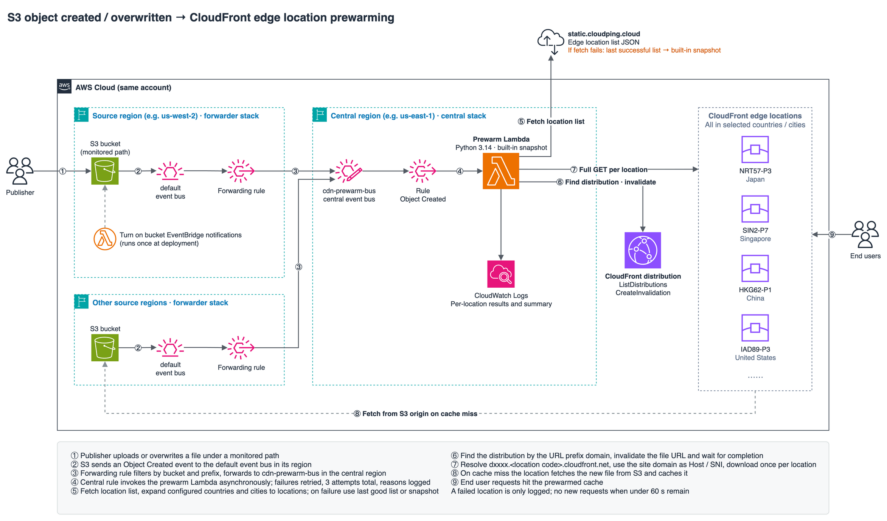

# Amazon CloudFront 边缘预热

[English](README.md) | 简体中文

本示例在 Amazon S3 中的内容变更时预热 Amazon CloudFront 边缘缓存。当配置的 S3 路径下有对象被创建或覆盖时，AWS Lambda 函数会从你所选国家或城市中的每个边缘站点各下载一次该对象，让这些站点在用户请求之前就缓存好新版本。

> **免责声明。** 本代码仅供演示和学习。在生产环境使用前，请自行完成安全、成本和运维方面的评估与测试。



```
S3 bucket (any region) ──> default event bus ──forwarding rule──> cdn-prewarm-bus (central region) ──> prewarm Lambda
                                                                                      1. invalidate the URL
                                                                                      2. GET it from each edge location
```

## 部署

存储桶、CloudFront 分配和中央堆栈必须在同一个 AWS 账户中。

**1. 部署中央堆栈**，只需一次，可选任意区域：

```bash
aws cloudformation deploy --region us-east-1 --stack-name cdn-prewarm \
  --template-file dist/cdn-prewarm-central.yaml --capabilities CAPABILITY_IAM \
  --parameter-overrides \
    "S3Paths=bucket-a/static/;bucket-b/img/" \
    "CdnUrlPrefixes=https://www.example.com/static/;https://img.example.com/" \
    "EdgeCountriesOrCities=Tokyo;Germany;United States" \
    "FilePatterns=*"
```

**2. 部署转发堆栈**，在每个有存储桶的区域各部署一个，传入中央堆栈的 `EventBusArn` 输出：

```bash
aws cloudformation deploy --region us-west-2 --stack-name cdn-prewarm-forwarder \
  --template-file dist/cdn-prewarm-forwarder.yaml --capabilities CAPABILITY_IAM \
  --parameter-overrides \
    "CentralEventBusArn=arn:aws:events:us-east-1:111122223333:event-bus/cdn-prewarm-bus" \
    "BucketNames=bucket-a" \
    "KeyPrefixes=static/;img/"
```

**部署者权限。** `deployer-policy.json` 包含部署所需的 IAM 权限。它只覆盖名为 `cdn-prewarm*` 的资源，因此堆栈名请保留这个前缀。其中的 ARN 使用 `arn:*:`，适用于所有 AWS 分区。从控制台部署还需要对 `cf-templates-*` 存储桶的 `s3:CreateBucket`、`s3:PutObject` 和 `s3:GetObject` 权限。

**`deployer-policy.json` 等同于管理员权限，只能授予可信的部署者。** 部署者可以创建带任意内联策略的 `cdn-prewarm*` 角色，将其传给 Lambda，并在 `cdn-prewarm*` 函数中运行任意代码，因此实际上可以获得任何权限。如需限制，请使用[权限边界](https://docs.aws.amazon.com/zh_cn/IAM/latest/UserGuide/access_policies_boundaries.html)：

- 在 `iam:CreateRole` 和 `iam:PutRolePolicy` 上加 `iam:PermissionsBoundary` 条件，强制使用权限边界。
- 拒绝 `iam:DeleteRolePermissionsBoundary`。
- 在两个模板的角色上设置 `PermissionsBoundary`。

## 参数

列表值用 `;` 分隔。

**中央堆栈**

| 参数 | 说明 |
|---|---|
| S3Paths | 要监控的路径，格式为 `bucket/prefix/` 或 `bucket`。 |
| CdnUrlPrefixes | 每个 S3 路径对应一个 URL 前缀，顺序与 S3Paths 一致。 |
| EdgeCountriesOrCities | 国家或城市。默认 `Tokyo;Germany;United States`。 |
| FilePatterns | 文件名模式，例如 `*.mp4;*.m3u8`。默认 `*`。 |
| InvalidateBeforePrewarm | 默认 `true`。如果文件会被覆盖，请保持开启。 |
| ReservedConcurrency | 同时预热的最大文件数。默认 `10`；留空则不设上限。参见[成本与限制](#成本与限制)。 |
| EdgeLocationsUrl | 可选。留空（默认）时只使用代码中自带的快照。参见[边缘站点列表](#边缘站点列表)。 |

预热 URL 是 URL 前缀加上对象键的剩余部分。例如 `bucket-a/static/` 对应 `https://www.example.com/static/`，上传 `static/js/app.js` 时会预热 `https://www.example.com/static/js/app.js`。Lambda 根据 URL 的域名查找对应的分配。

地名取自边缘站点列表，默认是 `src/prewarm.py` 中的 `EDGE_SNAPSHOT` 块。匹配时忽略大小写、重音符号和标点，州代码可省略（`Los Angeles` 能匹配 `Los Angeles, CA`）。香港和台湾（城市为 `Taipei`）作为独立地点列出。打印全部国家和城市：

```bash
python3 -c "import ast,re; s=open('src/prewarm.py').read(); d=ast.literal_eval(re.search(r'^EDGE_SNAPSHOT = (\{.*?^\})', s, re.S|re.M)[1]); [print(c, '-', '; '.join(d[c])) for c in d]"
```

**转发堆栈**

| 参数 | 说明 |
|---|---|
| CentralEventBusArn | 中央堆栈的 `EventBusArn` 输出。 |
| BucketNames | 本区域的存储桶，例如 `bucket-a;bucket-b`。 |
| KeyPrefixes | 可选。只转发这些前缀下的对象。 |
| EnableBucketEventBridge | 默认 `true`：为这些存储桶开启 EventBridge 通知。 |

## 边缘站点列表

Lambda 需要知道每个地点有哪些边缘站点。默认使用 `src/prewarm.py` 中的快照，运行时不下载任何内容。边缘站点会变化，请定期刷新快照（日期见 `EDGE_SNAPSHOT_DATE`；参见[开发](#开发)）。

AWS 不公布边缘站点代码列表。快照基于 [static.cloudping.cloud/cdn/cloudfront-edge-locations.json](https://static.cloudping.cloud/cdn/cloudfront-edge-locations.json) 生成，**这是第三方列表，AWS 不维护也不背书**。依赖它之前，请自行核实其准确性和使用条款。

如需在运行时下载列表，请将 `EdgeLocationsUrl` 设为你信任的 https URL。列表格式如下：

```json
{"edge_locations": [{"country": "Japan", "city": "Tokyo", "active_nodes": [{"code": "NRT12-P5"}]}]}
```

下载的列表缓存一小时。下载失败时改用快照。列表只决定请求哪些站点：代码必须符合 `AAA00-XX` 格式，请求始终发往 `<distribution>.<code>.cloudfront.net`。

## 查看结果

日志位于 `/aws/lambda/<中央堆栈名>-prewarm`：每个边缘站点一条 `prewarm_result`，每个文件一条 `prewarm_summary`。列出未成功的站点：

```
fields @timestamp, url, node, outcome, error
| filter type = "prewarm_result" and ok = 0
| sort @timestamp desc
```

`outcome` 为 `ok` 或 `failed`。如果 Lambda 超时，则为 `not_started` 或 `aborted`。

## 用 curl 验证

```bash
DOMAIN=www.example.com              # CdnUrlPrefixes 中的域名
FILE_PATH='/static/js/my_app.js'
NODE=NRT12-P5                       # 该文件 prewarm_result 日志中的站点代码
DIST=d111111abcdef8                 # 分配域名 dxxxx.cloudfront.net 的前缀

URL_PATH=$(jq -rn --arg p "$FILE_PATH" '$p | split("/") | map(@uri) | join("/")')

curl -sI -m 15 --retry 3 --retry-all-errors -H 'Accept-Encoding: gzip, deflate, br' \
  --connect-to "$DOMAIN:443:$DIST.$NODE.cloudfront.net:443" \
  "https://$DOMAIN$URL_PATH" | grep -iE '^(HTTP/|x-cache:|x-amz-cf-pop:|etag:|age:)'
```

预热成功时会看到：

- `x-amz-cf-pop` 等于 `NODE`
- `x-cache: Hit from cloudfront`，或 `RefreshHit`（缓存副本已过期，并已向源站重新验证）
- `etag` 与 S3 中的一致

没有输出说明你的网络无法访问该站点。

## 成本与限制

每个匹配路径的新建或覆盖文件会产生以下费用：

- **CloudFront 数据传出**：约为文件大小 × 站点数，按各站点所在区域的费率计费，另加每个站点一次 HTTPS 请求。默认地点会选中 81 个站点，因此一个 100 MB 的文件约传输 8 GB。
- **一个失效路径**，当 `InvalidateBeforePrewarm` 为 `true` 时产生。整个账户每月前 1,000 个路径免费，之后按撰写本文时的价格每个路径 0.005 美元。例如每月上传 10,000 次约花费 45 美元。参见[为文件失效付费](https://docs.aws.amazon.com/zh_cn/AmazonCloudFront/latest/DeveloperGuide/PayingForInvalidation.html)和 [CloudFront 定价](https://aws.amazon.com/cloudfront/pricing/)。
- **Lambda 运行时长**，内存 1,024 MB：等待失效完成的时间（通常 10 到 60 秒，最长 300 秒）加上下载时间。

上传 N 个文件会启动 N 次预热。`ReservedConcurrency`（默认 10）限制同时运行的数量。其余请求在 Lambda 异步队列中等待，6 小时后丢弃。按每个文件约一分钟计算，一次突发大约可处理 3,600 个文件。为更大的突发调高上限前，请注意：

- CloudFront 每秒最多接受 150 个失效路径（[配额](https://docs.aws.amazon.com/zh_cn/AmazonCloudFront/latest/DeveloperGuide/cloudfront-limits.html#limits-invalidations)）。
- 预留并发从账户的 Lambda 并发中扣除，账户必须至少保留 100 个未预留并发。

在繁忙路径上启用前，请先设置预算和告警（例如 AWS Budgets）。

## 注意事项

- **分配必须开启缓存**，否则预热不起作用。
- **按站点访问的主机名不是 CloudFront 的公开文档接口。** Lambda 通过 `<distribution>.<code>.cloudfront.net` 访问各站点，例如 `d111111abcdef8.NRT12-P5.cloudfront.net`。这些名称可能随时失效或变更，且不另行通知。
- **不要监控写入日志的路径**，否则每次预热都会触发新的预热。
- **失败处理。** 失败的站点不会重试。如果所有站点都失败，Lambda 会将整个事件重试两次，然后丢弃。如需重新预热，请重新上传文件。
- **权限。** Lambda 可以对账户中的任意分配（`distribution/*`）创建失效，因为它在运行时根据 `CdnUrlPrefixes` 的主机名查找分配。

## 清理

1. 先在每个区域删除转发堆栈，再删除中央堆栈。这会删除规则、事件总线、Lambda 函数及其角色和日志组（包括其中的日志）。

   ```bash
   aws cloudformation delete-stack --region us-west-2 --stack-name cdn-prewarm-forwarder
   aws cloudformation delete-stack --region us-east-1 --stack-name cdn-prewarm
   ```

2. **存储桶的 EventBridge 通知会保持开启**，因为其他应用可能在使用。没有规则后，这些事件不会被投递到任何地方。如需关闭，在 S3 控制台打开存储桶，选择 **Properties**，将 **Amazon EventBridge** 设为 **Off**。也可以用 CLI，这样会保留存储桶的其他通知设置：

   ```bash
   B=bucket-a
   aws s3api get-bucket-notification-configuration --bucket "$B" \
     | jq 'del(.EventBridgeConfiguration)' > notification.json
   aws s3api put-bucket-notification-configuration --bucket "$B" \
     --notification-configuration file://notification.json
   ```

## 开发

修改 `src/` 后，运行 `python3 build.py` 重新生成 `dist/`。如需从上述格式的列表刷新边缘站点快照，运行 `python3 refresh_edge_snapshot.py <edge-list-url>`，再运行 `python3 build.py`。

## 安全

详见 [CONTRIBUTING](CONTRIBUTING.md#security-issue-notifications)。

## 许可证

本库采用 MIT-0 许可证，详见 [LICENSE](LICENSE) 文件。
